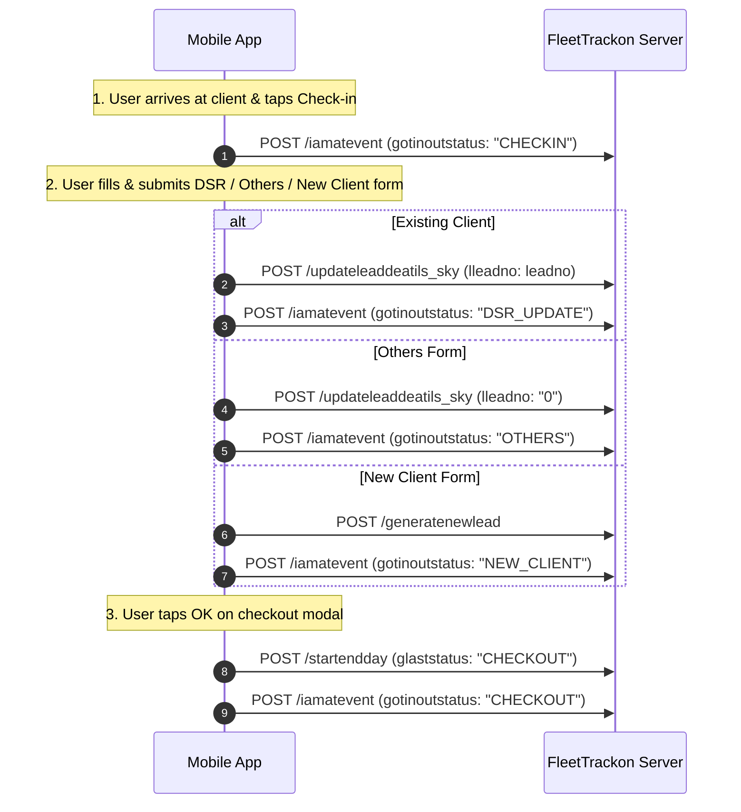

# SkyDiary - App & Web Button-to-API Complete Mapping Guide
**Document Version:** 1.0.0  
**Date:** 22-10-2026  
**Reference File:** `DiaryApiLinks_Malhar.txt`  
**Base Server URL:** `https://fleettrackon.co.in/pcsdia/`

---

## 📌 Context & Requirement (Sir's Instruction)
> **Requirement (WhatsApp Marathi):**  
> *"hyat app cha ani web cha je button taklet te add karun deu sakta"*  
>  
> **Meaning (Hindi):**  
> *"Is file (`DiaryApiLinks_Malhar.txt`) me jo APIs hain, unke hisaab se Mobile App aur Admin Web Portal me jo-jo buttons/screens/tabs dale gaye hain, unhe add aur connect karke do."*

This document maps **every UI button, screen action, and report tab** across both the **Mobile App** (MAUI/Cordova) and the **Admin Web Portal** directly to their corresponding backend APIs, payload structures, methods, and validation rules.

---

## 📱 Part 1: Mobile App Button & Action-to-API Mapping

| Sr | Mobile App Screen | Button / Action Name | API Endpoint | HTTP Method | Purpose / Description |
|:---|:---|:---|:---|:---:|:---|
| 1 | Login / Splash Screen | **Login / Register Device** | `/RegisterDiaDevice` | POST | Authenticates user and links Android Device GUID / IMEI with user profile. |
| 2 | Background GPS Service | **Auto GPS Tracker Ping** | `/receiveddata` | POST | Automatically pings device coordinates every 2-5 minutes during workday. |
| 3 | Dashboard | **"Day Start" Button** | `/startendday` + `/iamatevent` | POST | Starts employee's workday (`glaststatus: "START"` and `gotinoutstatus: "START"`). |
| 4 | Client Visit Screen | **"Check In" Button** | `/iamatevent` | POST | Records visit check-in time and GPS coordinates (`gotinoutstatus: "CHECKIN"`). |
| 5 | DSR Form | **Client Search / Dropdown** | `/getclientlistbygroup` | POST | Fetches list of existing clients assigned to user's group. |
| 6 | DSR Form | **"Submit DSR" Button** | `/updateleaddeatils_sky` + `/iamatevent` | POST | Updates existing client remark, next followup, and logs `gotinoutstatus: "DSR_UPDATE"`. |
| 7 | New Client Screen | **"Save Client" Button** | `/generatenewlead` + `/iamatevent` | POST | Registers a brand new client with PAN, GST, contact details, and logs `NEW_CLIENT`. |
| 8 | Others Visit Screen | **"Submit Others" Button** | `/updateleaddeatils_sky` + `/iamatevent` | POST | Submits visit to unlisted/other party with `lleadno: "0"` and logs `OTHERS`. |
| 9 | Visit Success Modal | **"OK" Button (Checkout)** | `/startendday` + `/iamatevent` | POST | Completes visit triad with `glaststatus: "CHECKOUT"` and `gotinoutstatus: "CHECKOUT"`. |
| 10 | Dashboard | **"Day End" Button** | `/startendday` + `/iamatevent` | POST | Ends employee's workday (`glaststatus: "END"` and `gotinoutstatus: "END"`). |
| 11 | Leaves Screen | **Leave Balance Cards** | `/totalleaves_check` | POST | Fetches user balance for EL, CL, SL, OL, WP. |
| 12 | Leaves Screen | **Leave Applied Counter** | `/totalleaves_applied` | POST | Fetches count of applied leaves for each category. |
| 13 | Apply Leave Screen | **"Apply Leave" Submit Button** | `/empleave_n_v0` | POST | Submits leave application to HR/Admin. |
| 14 | Leave Status Tab | **"View Applied Leaves"** | `/getleavereport` | POST | Displays status of employee's leave applications (Pending, Approved, Rejected). |
| 15 | Reminders Tab | **"Today's Reminders"** | `/getfollowupalert` | POST | Fetches today's scheduled follow-ups and alerts. |

---

## 🌐 Part 2: Admin Web Portal Tab & Button-to-API Mapping

| Sr | Web Portal Tab / Button | API Endpoint | HTTP Method | Key Parameters Sent | Output Columns / Display |
|:---|:---|:---|:---:|:---|:---|
| 1 | **DSR Summary** Tab | `/dailyreportformatsummary_v3` | POST | `gemptype: 'admin'`, `gempname: 'All'`, `sum_from`, `sum_till`, `dsruser: 'All'` | `SR NO`, `CLIENT NAME`, `SITE NAME`, `VISITED FOR`, `ASSIGNED TO`, `NO OF VISIT` |
| 2 | **DSR Client Report** Tab | `/getdsrleadreport_vo1` *(fallback: `/getdsrleadreport_v1`)* | POST | `aim: 'aim'`, `gempname: 'All'`, `gemptype: 'grouphead'`, `gempcluster: ''` | `SR NO`, `ASSIGNED EMP`, `REGISTERED ON`, `CLIENT`, `SITE NAME`, `OFFICE ADDRES`, `CONTACT PERSON`, `CONTACT`, `CURRENT REMARK`, `FOLLOWUP` |
| 3 | **Day End Summary 2** Tab | `/getiamatsummaryrtp_2` | POST | `startdate: 'YYYY/MM/DD'`, `enddate: 'YYYY/MM/DD 23:59'`, `gempname`, `username: 'All'` | `SRNO`, `EMPNAME`, `DATED`, `START`, `IN`, `DSR`, `OUT`, `END`, `DURATION`, `ACTIVITY`, `CLIENT`, `LOCATION`, `LATLONG` |
| 4 | **Check In/Out Status** Tab | `/getinoutdetails_v1` | POST | `startdatep`, `enddatep`, `userv`, `clientv`, `gempname` | `SR NO`, `EMPNAME`, `CHECKIN`, `IN LOCATION`, `IN LATLONG`, `CHECKOUT`, `OUT LOCATION`, `OUT LATLONG`, `DURATION` |
| 5 | **Start/End Day Report** Tab | `/getcheckinoutrtp` | POST | `startdate`, `enddate`, `gempname`, `username` | `SRNO`, `EMPNAME`, `STARTENDTIME`, `RECEIVEDON`, `START/END`, `LOCATION`, `DURATION` |
| 6 | **Travel Path** Tab | `/receiveddata` / `/gettravelpath_v1` | POST | `useruniqeid`, `imeino`, `trackdate` | `SRNO`, `USER NAME`, `LOCATION`, `ADDRESS`, `TRACKDATE`, `SPEED`, `ISGPS` |
| 7 | **Booking Report** Tab | `/getdsrleadreport_vo1` | POST | Filtered by booking leads | `SR NO`, `BOOKING NO`, `DATE`, `CLIENT`, `SITE NAME`, `QUANTITY`, `RATE`, `TOTAL AMOUNT`, `STATUS` |

---

## 🔌 Part 3: Complete 19 APIs Technical Reference

### 1) Device Registration
* **Endpoint:** `POST https://fleettrackon.co.in/pcsdia/RegisterDiaDevice`
* **Triggered by:** App Login Screen / First Launch
* **Request Body:**
```json
{
  "UserId": "11",
  "GuId": "a057d027fed7bace"
}
```
* **Response:**
```json
{
  "output": [
    {
      "resstatus": "Already Registered",
      "id": 11,
      "userid": 11,
      "userloginid": "a057d027fed7bace",
      "userfullname": "demo admin2",
      "usertype": "admin",
      "imeinumber": "a057d027fed7bace",
      "clientid": 27
    }
  ]
}
```

---

### 2) Get DSR Client List (For Dropdown)
* **Endpoint:** `POST https://fleettrackon.co.in/pcsdia/getclientlistbygroup`
* **Triggered by:** App DSR Form Open / Client Selection Dropdown
* **Request Body:**
```json
{
  "userid": "demo admin2",
  "gemptype": "admin",
  "leadnametosearch": "",
  "groupnametosearch": "",
  "gempcluster": ""
}
```
* **Response:** Returns `trackerid` array of pre-registered clients with `leadno`, `leadname`, `leadsitename`, `address`, `contactno`, `assignedto`.

---

### 3) Periodic GPS Tracking Ping
* **Endpoint:** `POST https://fleettrackon.co.in/pcsdia/receiveddata`
* **Triggered by:** Background Service (Every 2-5 min during Day Start)
* **Request Body:**
```json
{
  "useruniqeid": 11,
  "imeino": "a057d027fed7bace",
  "deviceid": "GPS FIX",
  "gpsLatitude": "17.7012028",
  "gpsLongitude": "73.982616",
  "gpsAccuracy": "13.74",
  "gpsSpeed": "0.24",
  "gpsTimestamp": "2026-06-20 13:08",
  "calbaering": 90
}
```

---

### 4) Last Activity Event Log (iamatevent)
* **Endpoint:** `POST https://fleettrackon.co.in/pcsdia/iamatevent`
* **Triggered by:** Start Day, Check In, DSR Update, Others, New Client, Checkout, End Day
* **Request Body:**
```json
{
  "gotiamatdate": "2026-10-22 10:25:00",
  "gotempname": "demo group",
  "gotempid": "6",
  "gotinoutstatus": "CHECKIN",
  "gotiamatclient": "Test Client Pvt Ltd",
  "gotiamatlat": 18.4748182,
  "gotiamatlong": 73.8119225,
  "gimeinumber": "a057d027fed7bace"
}
```
* **Allowed Values for `gotinoutstatus`:**
  - `START`
  - `CHECKIN`
  - `DSR_UPDATE`
  - `OTHERS`
  - `NEW_CLIENT`
  - `CHECKOUT`
  - `END`

---

### 5) Workday Start & End Day
* **Endpoint:** `POST https://fleettrackon.co.in/pcsdia/startendday`
* **Triggered by:** "Day Start" button, "Day End" button, and Visit Checkout
* **Request Body (Day Start):**
```json
{
  "gcdatetime": "2026-10-22 09:30",
  "glaststatus": "START",
  "empid": "demo group",
  "imeino": "a057d027fed7bace",
  "gpsLatitude": 18.4748182,
  "gpsLongitude": 73.8119225
}
```
* **Request Body (Checkout):**
```json
{
  "gcdatetime": "2026-10-22 10:30",
  "glaststatus": "CHECKOUT",
  "empid": "demo group",
  "imeino": "a057d027fed7bace",
  "gpsLatitude": 18.4748182,
  "gpsLongitude": 73.8119225
}
```
* **Request Body (Day End):**
```json
{
  "gcdatetime": "2026-10-22 18:30",
  "glaststatus": "END",
  "empid": "demo group",
  "imeino": "a057d027fed7bace",
  "gpsLatitude": 18.4748182,
  "gpsLongitude": 73.8119225
}
```

---

### 6 & 9) Update Existing Client DSR
* **Endpoint:** `POST https://fleettrackon.co.in/pcsdia/updateleaddeatils_sky`
* **Triggered by:** App DSR Form "Submit" Button
* **Request Body:**
```json
{
  "userid": "6",
  "gemptype": "grouphead",
  "currentdatetime": "2026-10-22 10:24",
  "intime": "00:00:00",
  "outtime": "00:00:00",
  "outletname": "Test Client Pvt Ltd",
  "nleadname": "Test Client Pvt Ltd",
  "ncontact": "9876543210",
  "nremark": "Visit completed successfully",
  "nfollowup": "2026-10-25",
  "nfollowuptime": "11:00",
  "assignedemp": "All",
  "gpsLatitude": "18.4748182",
  "gpsLongitude": "73.8119225",
  "l_nremark": "Last Remark",
  "n_nremark": "Payment Followup",
  "leaddatetime": "2026-10-22 10:24",
  "officeaddres": "Kothrud, Pune",
  "contactperson": "Mr. Sharma",
  "gempname": "demo group",
  "follow_rem": "Payment Followup",
  "lleadno": "2192"
}
```

---

### 8) Generate New Client (Brand New Lead)
* **Endpoint:** `POST https://fleettrackon.co.in/pcsdia/generatenewlead`
* **Triggered by:** App "New Client" Registration Form "Save" Button
* **Request Body:**
```json
{
  "userid": "6",
  "gemptype": "grouphead",
  "assignedemp": "All",
  "CustomerName": "Acme Industries",
  "CustomerType": "Client",
  "PANNumber": "ABCDE1234F",
  "GSTNumber": "27ABCDE1234F1Z5",
  "officeaddress": "Shivaji Nagar, Pune",
  "MobileNumber": "9876543210",
  "landlinenumber": "",
  "EmailAddress": "contact@acme.com",
  "FullName1": "Manager Name",
  "FullName2": "",
  "FullName3": "",
  "FullName4": "",
  "outletname": "Acme Industries",
  "nleadname": "Acme Industries",
  "ncontact": "9876543210",
  "nlanddine": "",
  "BankAccount": "",
  "BankName": "",
  "BankAddress": "",
  "ifsccode": "",
  "onereference1": "",
  "onereference2": "",
  "currentdatetime": "2026-10-22 10:30",
  "intime_h": "00",
  "intime_m": "00",
  "outtime_h": "00",
  "outtime_m": "00",
  "ocos": "Open",
  "ncns": "New",
  "nremark": "Initial discussion",
  "nfollowup": "2026-10-26",
  "nfollowuptime_h": "12",
  "nfollowuptime_m": "00",
  "c_assignedto": "All",
  "gpsLatitude": "18.4748182",
  "gpsLongitude": "73.8119225"
}
```

---

### 10) Other Client / Unlisted Client Visit API
* **Endpoint:** `POST https://fleettrackon.co.in/pcsdia/updateleaddeatils_sky`
* **Triggered by:** App "Others" Form "Submit" Button
* **Critical Note:** `lleadno` **MUST be set to `"0"`** (not empty string `""`), otherwise the backend stored procedure drops the record.
* **Request Body:**
```json
{
  "userid": "6",
  "gemptype": "grouphead",
  "currentdatetime": "2026-10-22 10:45",
  "intime": "00:00:00",
  "outtime": "00:00:00",
  "outletname": "Metro Site Office",
  "nleadname": "Metro Site Office",
  "ncontact": "9988776655",
  "nremark": "Discussion regarding project",
  "nfollowup": "2026-10-27",
  "nfollowuptime": "14:00",
  "assignedemp": "All",
  "gpsLatitude": "18.4748182",
  "gpsLongitude": "73.8119225",
  "l_nremark": "Discussion regarding project",
  "n_nremark": "Discussion regarding project",
  "leaddatetime": "2026-10-22 10:45",
  "officeaddres": "Baner, Pune",
  "contactperson": "Mr. Patil",
  "gempname": "demo group",
  "follow_rem": "Discussion regarding project",
  "lleadno": "0"
}
```

---

### 11) DSR Client Report (Live Report API)
* **Endpoint:** `POST https://fleettrackon.co.in/pcsdia/getdsrleadreport_v1`
* **Triggered by:** Web Portal "DSR Client Report" Tab
* **Request Body:**
```json
{
  "startdatep": "2026/10/22",
  "enddatep": "2026/10/23",
  "userv": "All",
  "clientv": "All",
  "gempname": "All"
}
```

---

### 12) Total Leaves Check (Balance)
* **Endpoint:** `POST https://fleettrackon.co.in/pcsdia/totalleaves_check`
* **Triggered by:** App Leave Screen Open
* **Request Body:**
```json
{
  "empname": "demo group",
  "clientid": "27",
  "userid": "6"
}
```

---

### 13) Total Leaves Applied
* **Endpoint:** `POST https://fleettrackon.co.in/pcsdia/totalleaves_applied`
* **Triggered by:** App Leave Screen Open
* **Request Body:**
```json
{
  "empname": "demo group",
  "clientid": "27",
  "userid": "6"
}
```

---

### 14) Leave Application Submit
* **Endpoint:** `POST https://fleettrackon.co.in/pcsdia/empleave_n_v0`
* **Triggered by:** App "Apply Leave" Form "Submit" Button
* **Request Body:**
```json
{
  "department": "Sales",
  "name": "demo group",
  "totalleave": "2",
  "requiredfrom": "2026-10-25",
  "leavetype": "CL",
  "fullhalf": "Full",
  "reason": "Personal work",
  "requiredtill": "2026-10-26",
  "in_absence": "Mr. Kadam",
  "clientid": "27"
}
```

---

### 15) Leaves Status Report
* **Endpoint:** `POST https://fleettrackon.co.in/pcsdia/getleavereport`
* **Triggered by:** App / Web "Leave Status / Report" Button
* **Request Body:**
```json
{
  "gempname": "demo group"
}
```

---

### 16) DSR Summary Report
* **Endpoint:** `POST https://fleettrackon.co.in/pcsdia/dailyreportformatsummary_v3`
* **Triggered by:** Web Portal "DSR Summary" Tab
* **Critical Notes:**
  - `sum_from`: `YYYY/MM/DD` (e.g., `2026/10/22`)
  - `sum_till`: `YYYY/MM/DD` + 1 Day (e.g., `2026/10/23`) to capture entire day
  - `gempname`: Pass `"All"` to return all visits saved with assigned emp
* **Request Body:**
```json
{
  "gemptype": "admin",
  "gempname": "All",
  "sum_from": "2026/10/22",
  "sum_till": "2026/10/23",
  "dsruser": "All"
}
```
* **Sample Response:**
```json
{
  "trackerid": [
    {
      "vendorname": "Test Client Pvt Ltd",
      "sitename": "Test Client Pvt Ltd",
      "assignedto": "All",
      "noofvisite": "1",
      "gonefor": "Visit Done"
    },
    {
      "vendorname": "Metro Site Office",
      "sitename": "Metro Site Office",
      "assignedto": "All",
      "noofvisite": "1",
      "gonefor": "Discussion regarding project"
    }
  ]
}
```

---

### 17) DSR Updated List (Alternative Client Report)
* **Endpoint:** `POST https://fleettrackon.co.in/pcsdia/getdsrleadreport_vo1`
* **Triggered by:** Web Portal DSR Client Report Fetch
* **Request Body:**
```json
{
  "aim": "aim",
  "gempname": "All",
  "gemptype": "grouphead",
  "gempcluster": ""
}
```

---

### 18) Start End Day Report
* **Endpoint:** `POST https://fleettrackon.co.in/pcsdia/getcheckinoutrtp`
* **Triggered by:** Web Portal "Day Start/End Report" Tab
* **Request Body:**
```json
{
  "startdate": "2026/10/22",
  "enddate": "2026/10/22 23:59",
  "gempname": "demo group",
  "username": "All"
}
```

---

### 19) Today's Follow-up Alert / Reminders
* **Endpoint:** `POST https://fleettrackon.co.in/pcsdia/getfollowupalert`
* **Triggered by:** App "Reminders" Screen / Dashboard Notification
* **Request Body:**
```json
{
  "gemptype": "admin",
  "gempname": "demo group"
}
```

---

## 🔄 Part 4: Mandatory Visit Triad Sequence

For every client visit (both **Online** submission and **Offline Sync**), the following chronological triad sequence is strictly enforced:



---
*Created automatically for SkyDiary Project Architecture.*  
*Original `DiaryApiLinks_Malhar.txt` remains intact and unmodified.*
